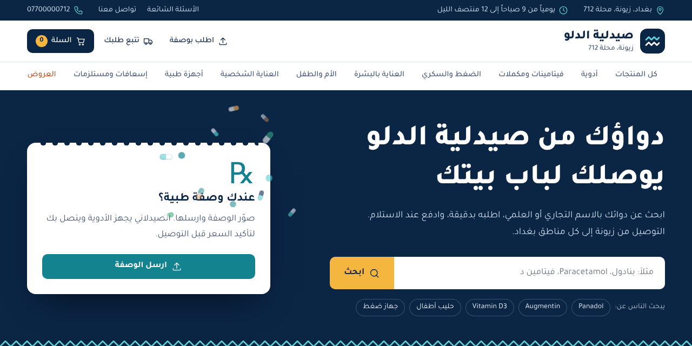
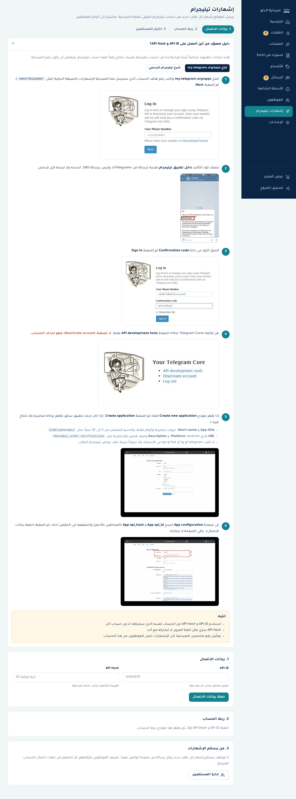

# صيدلية الدلو

متجر إلكتروني لصيدلية الدلو (بغداد، زيونة، محلة 712) مبني على Laravel 13.
الزبون يطلب من الموقع، والطلب يصل فوراً إلى موظفي الصيدلية على تيليجرام من حساب الصيدلية نفسه.



**كل الصور مع الشرح: [docs/SCREENSHOTS.md](docs/SCREENSHOTS.md)** (64 صورة على سطح المكتب والتابلت والموبايل).

## ما يحتويه الموقع

**واجهة الزبائن**

- بحث بالاسم التجاري أو العلمي أو الباركود مع اقتراحات أثناء الكتابة
- أقسام، عروض وخصومات، وبدائل بنفس المادة الفعالة في صفحة كل دواء
- سلة وإتمام طلب بدون حساب، والدفع عند الاستلام، وأجور توصيل حسب المنطقة
- **استشر الصيدلانية**: زر في صفحة كل منتج وفي كل الصفحات يفتح واتساب قسم الاستشارات برسالة جاهزة تذكر أن الزبون قادم من الموقع ومعها اسم المنتج ورابطه
- **الطلب عبر واتساب**: من صفحة المنتج أو من السلة، ومحتوى السلة يُكتب في الرسالة تلقائياً
- الأدوية التي تصرف بوصفة تتطلب رفع صورتها، مع صفحة «اطلب بوصفة»
- تتبع الطلب، الأسئلة الشائعة، وصفحة تواصل معنا بنموذج رسالة
- تناثر كبسولات ملونة من موضع النقر أو اللمس في أي مكان من الموقع
- خط تجوّل، وتصميم متجاوب للموبايل والتابلت وسطح المكتب مع شريط تنقل سفلي في الموبايل

**لوحة التحكم** (`/admin`)

- الرئيسية: مؤشرات اليوم والشهر، رسم لطلبات آخر 14 يوماً، الأكثر مبيعاً، المخزون القليل، وتنبيه بالطلب الجديد دون تحديث الصفحة
- الطلبات: تصفية وبحث، تغيير الحالة، صورة الوصفة، فاتورة للطباعة، وتصدير إلى Excel
- المنتجات: إضافة وتعديل وصور وإجراءات جماعية
- **استيراد من Excel**: ترفع الملف، تختار أي عمود يقابل أي حقل، ويُستورد دفعة واحدة. المنتج الموجود يُحدَّث ولا يتكرر
- **إشعارات تيليجرام**: ربط حساب تيليجرام حقيقي من لوحة التحكم مع دليل مصوّر
- الموظفون: تضيفهم بأرقامهم أو تختارهم من جهات اتصال الحساب المرتبط
- الرسائل، الأسئلة الشائعة، الأقسام، والإعدادات (واتساب، التوصيل، بيانات الصيدلية)
- كل الصفحات تعمل على الموبايل والتابلت: قائمة منزلقة، والجداول تتحول إلى بطاقات

## التشغيل

المتطلبات: PHP 8.3 أو أحدث (64 بت) و Composer. لا يحتاج الموقع إلى Node أو أي خطوة بناء.

```bash
composer install
cp .env.example .env
php artisan key:generate
```

افتح `.env` وضع كلمة مرور المدير في `ADMIN_PASSWORD` (وإذا تركتها فارغة تُولَّد كلمة عشوائية وتُطبع مرة واحدة)، ثم:

```bash
php artisan migrate --seed
php artisan serve
```

- المتجر: http://127.0.0.1:8000
- لوحة التحكم: http://127.0.0.1:8000/admin (البريد `admin@aldalu.iq`)

قاعدة البيانات الافتراضية SQLite. لاستخدام MySQL عدّل قيم `DB_` في `.env`.
الأمر `migrate --seed` يضيف أقساماً وأدوية وأسئلة وموظفين تجريبيين لمعاينة الموقع. عدّلهم أو احذفهم من لوحة التحكم قبل الافتتاح.

عند الرفع على سيرفر: وجّه الدومين إلى مجلد `public`، واجعل `APP_ENV=production` و `APP_DEBUG=false` و `APP_URL` رابط موقعك بـ https.

## إعداد إشعارات تيليجرام

الموقع لا يستخدم بوتاً. يرسل من **حساب تيليجرام حقيقي** (رقم هاتف) عبر مكتبة [MadelineProto](https://docs.madelineproto.xyz)، فتصل الرسائل للموظفين بأرقامهم مباشرة دون أن يفعلوا شيئاً.

كل الخطوات من لوحة التحكم، صفحة «إشعارات تيليجرام»، وفيها دليل مصوّر:

1. افتح [my.telegram.org/apps](https://my.telegram.org/apps) وسجّل الدخول برقم الحساب الذي سترسل منه الصيدلية.
2. اضغط API development tools وأنشئ تطبيقاً، ثم انسخ `api_id` و `api_hash`. ([شرح تيليجرام الرسمي](https://core.telegram.org/api/obtaining_api_id))
3. الصقهما في لوحة التحكم واحفظ.
4. اكتب رقم الحساب بالصيغة الدولية، ثم الكود الذي يصلك في تطبيق تيليجرام، وكلمة مرور التحقق بخطوتين إن وُجدت.
5. من صفحة «الموظفون» أضف المستلمين بأرقامهم أو اخترهم من جهات الاتصال، وجرّب «إرسال تجربة».



ملاحظات:

- السيرفر يجب أن يصل إلى خوادم تيليجرام. إذا فشل الربط راجع [متطلبات MadelineProto](https://docs.madelineproto.xyz/docs/REQUIREMENTS.html) و `storage/logs/madelineproto.log`.
- جلسة الحساب تُحفظ في `storage/app/private/telegram` ولا تُرفع إلى المستودع. احفظها عند نقل الموقع، أو أعد الربط.
- `api_hash` سرّي مثل كلمة المرور.
- الإشعار يُرسل بعد ظهور صفحة التأكيد للزبون، فلا ينتظر الزبون تيليجرام.

## إعداد واتساب

من «الإعدادات»:

- **واتساب قسم الاستشارات**: يستقبل أسئلة زر «استشر الصيدلانية». تغيّر اسم القسم على الزر (الصيدلانية، الصيدلاني، د. فلانة).
- **واتساب الطلبات**: يستقبل طلبات زر «اطلب عبر واتساب».

مثال للرسالة التي تصل الصيدلانية:

```
مرحباً، أنا قادم من موقع صيدلية الدلو وأريد استشارة الصيدلانية عن هذا المنتج:
Augmentin 1g 14 قرص
https://example.com/product/6

سؤالي:
```

## الاختبارات

```bash
php artisan test
```
